# ASM503 – Parmak İzi Tanıma Araçları

FVC2000, FVC2002 ve FVC2004 parmak izi veri tabanları üzerinde, NIST Biometric Image Software (NBIS) Release 5.0.0 ve Raffaele Cappelli'nin [pyfing](https://github.com/raffaele-cappelli/pyfing) paketi temel alınarak geliştirilmiş parmak izi işleme ve tanıma araçları.

- **Görüntü araçları (C):** `tiff2raw`, `raw2bmp`, `raw2an2k`, `comp_img`
- **İyileştirme araçları (C, pyfing'in klasik yöntemlerinin uyarlaması):** `segmentation` (GMFS), `orientation` (GBFOE), `frequency` (XSFFE), `gabor_filter` (GBFEN)
- **Tanıma sistemi (Python betikleri):** `match.py` (gabor_filter + mindtct + bozorth3 ile FVC protokolüne göre skorlar), `det.py` (DET eğrisi ve EER)

## İçindekiler
1. [Sonuçlar](#1-sonuçlar)
2. [Dizin yapısı](#2-dizin-yapısı)
3. [Kurulum (yeni bir bilgisayarda sıfırdan)](#3-kurulum-yeni-bir-bilgisayarda-sıfırdan)
4. [Araçların kullanımı](#4-araçların-kullanımı)
5. [Parmak izi iyileştirme araçları](#5-parmak-izi-iyileştirme-araçları)
6. [Parmak izi eşleştirme](#6-parmak-izi-eşleştirme)
7. [Teslim edilen dosyalar](#7-teslim-edilen-dosyalar)

---

## 1. Sonuçlar

Gabor filtresi + NBIS `mindtct` + `bozorth3` sisteminin FVC protokolüne göre sonuçları:

| Veri tabanı | Görüntü boyutu | Genuine | Impostor | **EER** | EER aralığı | EER eşiği |
|---|---|---|---|---|---|---|
| FVC2000 DB1 | 300×300 | 2800 | 4950 | **%5,43** | %4,79 – %6,07 | 14 |
| FVC2002 DB1 | 388×374 | 2800 | 4950 | **%3,98** | %3,78 – %4,18 | 18 |
| FVC2004 DB1 | 640×480 | 2800 | 4950 | **%10,75** | %10,24 – %11,25 | 14 |

| FVC2000 DB1 | FVC2002 DB1 | FVC2004 DB1 |
|---|---|---|
| 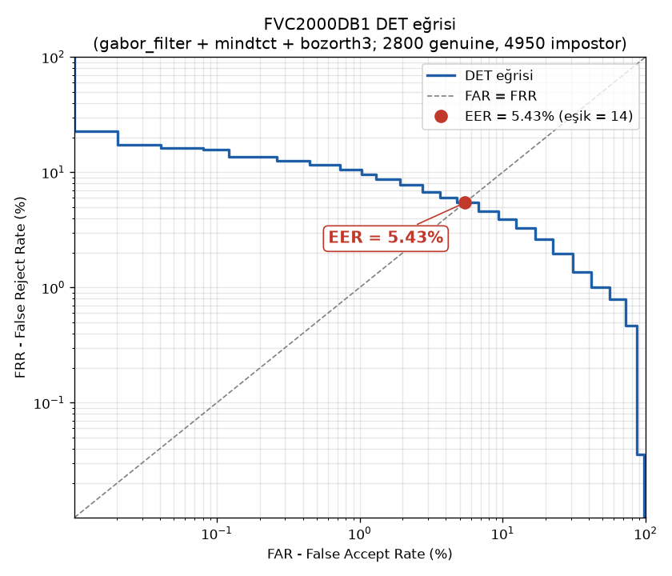 | 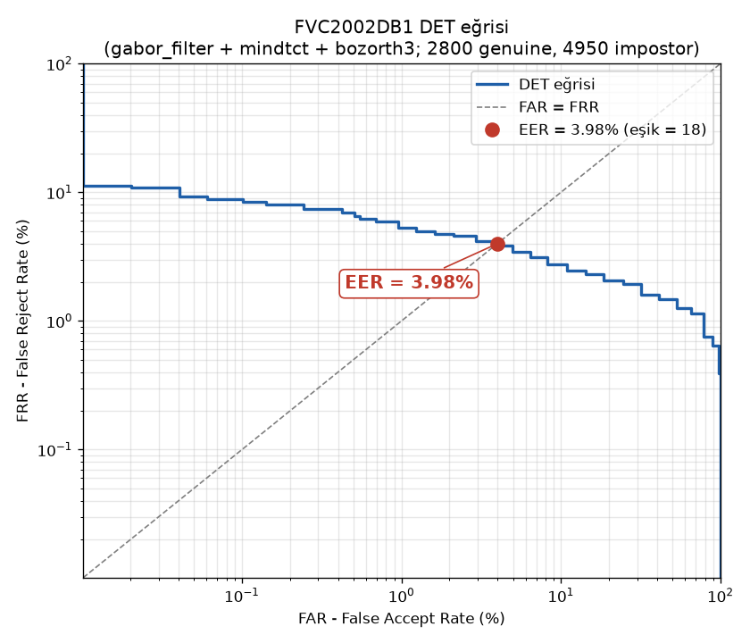 | 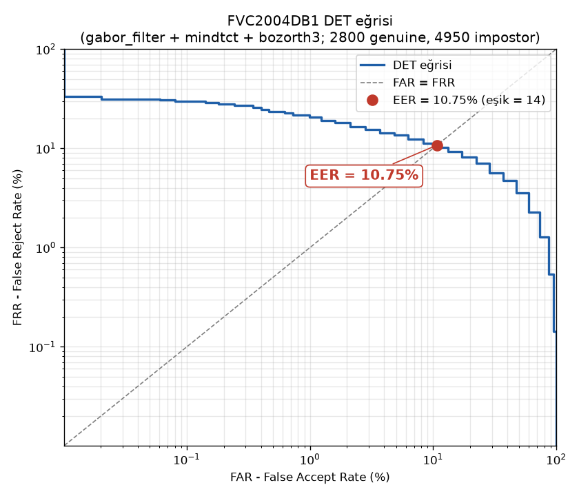 |

FVC2004 DB1'in yüksek EER değeri beklenen bir sonuçtur: bu yarışmada görüntüler parmak bilinçli olarak bükülüp döndürülerek (bozulmalı) alınmıştır ve üç veri tabanının en zorudur.

---

## 2. Dizin yapısı

```
ASM503/                     (bu depo = çalışma dizini)
├── bin/                    make install ile oluşan çalıştırılabilir dosyalar
├── images/                 ekran görüntüleri, örnek çıktılar, DET eğrileri
│   └── mindtct_results/    101_1 için mindtct çıktıları
├── scores/                 match.py'nin ürettiği genuine/impostor skor dosyaları
├── scripts/                Python betikleri
│   ├── match.py            FVC protokolüne göre eşleştirme skorları
│   ├── det.py              DET eğrisi ve EER
│   ├── pyfing_example.py   pyfing kurulum testi (Quick Example)
│   └── perturb_bmp.py      comp_img testi için piksel değiştirme
├── src/
│   ├── makefile            tüm araçları tek komutla derler
│   ├── common/             iyileştirme araçlarının ortak C kodu (fpimg.c/.h)
│   ├── tiff2raw/  raw2bmp/  raw2an2k/  comp_img/
│   └── segmentation/  orientation/  frequency/  gabor_filter/
└── requirements.txt        Python bağımlılıkları
```

Her aracın `src/<araç>/` dizininde kendi kaynak kodu ve `makefile`'ı vardır. Depo dışında, **aynı üst dizinde** şu dizinler beklenir (ödevdeki `..\nbis\bin\mindtct` örneğiyle aynı düzen):

```
<üst dizin>/  (örn. C:\Users\<kullanıcı>\Desktop)
├── ASM503/   bu depo
├── nbis/     NBIS 5.0.0 kurulumu (bin/mindtct.exe, bin/bozorth3.exe, ...)
├── FVC/      FVC veri tabanları (FVC2000/, FVC2002/, FVC2004/)
└── work/     ara dosyalar: gabor çıktıları, minutiae (match.py otomatik oluşturur)
```

FVC veri tabanları ve bunlardan gabor filtresiyle üretilen görüntüler bu nedenle çalışma dizininin dışında tutulur.

---

## 3. Kurulum (yeni bir bilgisayarda sıfırdan)

Geliştirme ve testler Windows 11 üzerinde, MSYS2 UCRT64 ortamında yapılmıştır.

### 3.1 MSYS2, gcc, make ve cmake

1. https://www.msys2.org adresinden MSYS2'yi indirip `C:\msys64` dizinine kurun.
2. **MSYS2 UCRT64** terminalini açıp paketleri güncelleyin (terminal kapanırsa yeniden açıp tekrarlayın):
   ```bash
   pacman -Syu
   ```
3. Derleyici ve araçları kurun:
   ```bash
   pacman -S mingw-w64-ucrt-x86_64-gcc make mingw-w64-ucrt-x86_64-cmake
   ```

Kullanılan sürümler: GNU make 4.4.1, gcc 16.2.0, cmake 4.5.1. MSYS2 her zaman en güncel gcc'yi kurar; kod standart C99'dur ve `-Wall -Wextra -pedantic` ile uyarısız derlenir, gcc 15.2.0 ile de aynı şekilde derlenmesi beklenir.

> Bundan sonraki tüm derleme komutları **MSYS2 UCRT64** terminalinde çalıştırılmalıdır (MSYS terminalinde gcc bulunmaz).

### 3.2 NBIS 5.0.0

1. [NIST NBIS sayfasından](https://www.nist.gov/services-resources/software/nist-biometric-image-software-nbis) Release 5.0.0 kaynak kodunu indirip açın (örn. `Desktop\Rel_5.0.0`).
2. MSYS2 UCRT64 terminalinde (yolları kendi kullanıcı adınıza göre değiştirin):
   ```bash
   mkdir -p /c/Users/<kullanıcı>/Desktop/nbis
   cd /c/Users/<kullanıcı>/Desktop/Rel_5.0.0
   ./setup.sh C:/Users/<kullanıcı>/Desktop/nbis --MSYS --64

   # gcc >= 10 için: header'larda tanımlı global değişkenler "multiple definition" hatası verir
   sed -i 's/-O2 -w -ansi/-O2 -w -fcommon -ansi/' rules.mak

   # cmake >= 4 için: NBIS'teki openjp2, 3.5'ten eski CMake sürümü ister
   export CMAKE_POLICY_VERSION_MINIMUM=3.5

   make config
   make it
   make install
   ```
3. Kontrol: `nbis/bin` altında 61 program (`mindtct.exe`, `bozorth3.exe`, ...) olmalıdır.

**Karşılaşılan sorunlar ve çözümleri:**

| Hata | Sebep | Çözüm |
|---|---|---|
| `setup.sh`: *Directory ... doesn't exist!* | Kurulum dizini önceden var olmalı | `mkdir -p` ile oluşturmak |
| `make config`: *Compatibility with CMake < 3.5 has been removed* | NBIS'in openjp2 kütüphanesi eski CMake sürümü istiyor, CMake 4 bunu desteklemiyor | `export CMAKE_POLICY_VERSION_MINIMUM=3.5` |
| `make it`: *multiple definition of `histo_head'* | gcc 10'dan itibaren varsayılan `-fno-common`; NBIS header'da değişken tanımlıyor | `rules.mak` içinde CFLAGS'a `-fcommon` eklemek |

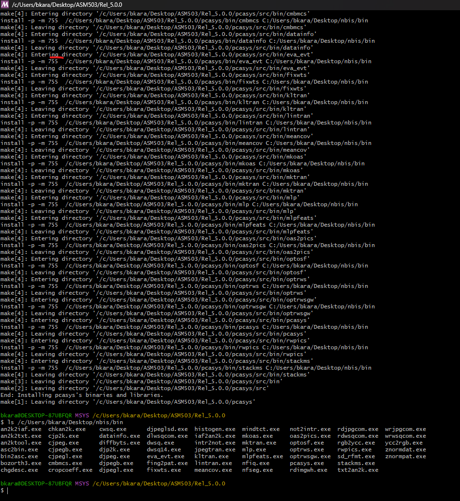

### 3.3 Python 3.13 ve pyfing

pyfing'in bağımlılığı olan TensorFlow'un kararlı sürümü (2.21) Python 3.10–3.13'ü destekler; Python 3.14 için yalnızca test (rc) sürümleri vardır. Bu nedenle proje Python 3.13 ile, depo içinde bir sanal ortamda (`.venv`, depoya dahil değildir) çalıştırılır. PowerShell'de, depo dizininde:

```powershell
py install 3.13                         # Python Install Manager ile 3.13 kurulumu
py -V:3.13 -m venv .venv
.venv\Scripts\python -m pip install -r requirements.txt
```

`requirements.txt`, pyfing README'sinde belirtilen paketlere ek olarak pyfing'in belirtmediği iki bağımlılığı da içerir: `scipy` ve `opencv-contrib-python` (pyfing `cv.ximgproc.thinning` kullanır; bu modül standart `opencv-python` paketinde yoktur). `matplotlib` ise `det.py` içindir.

Kurulum testi (pyfing GitHub sayfasındaki *Quick Example*, `fingerprint.png` yerine FVC2002 DB1 `101_1.tif` ile):

```powershell
$env:TF_CPP_MIN_LOG_LEVEL='2'     # TensorFlow bilgi mesajlarını azaltır
.venv\Scripts\python scripts\pyfing_example.py
```

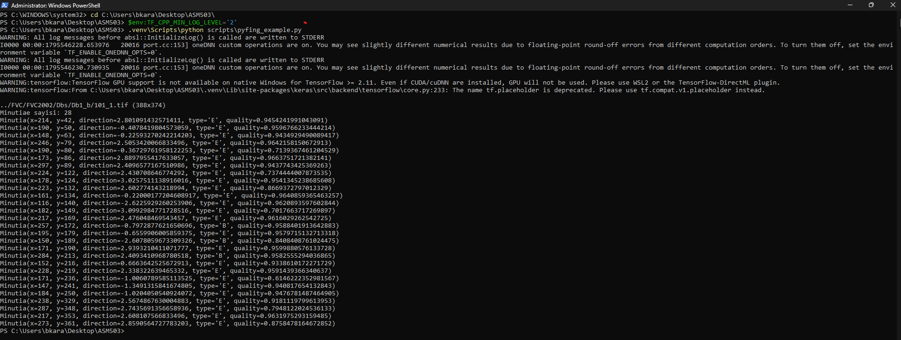

### 3.4 FVC veri tabanları

*Handbook of Fingerprint Recognition* (3. baskı) kitabının [ek materyali](https://static-content.springer.com/esm/chp%3A10.1007%2F978-3-030-83624-5_4/MediaObjects/74034_3_En_4_MOESM1_ESM.zip) olan zip dosyasını indirip depo ile aynı üst dizinde `FVC` adıyla açın. Beklenen yapı:

```
FVC/FVC2000/Dbs/Db1_a/1_1.tif ... 100_8.tif
FVC/FVC2002/Dbs/Db1_a/...   FVC/FVC2002/Dbs/Db1_b/101_1.tif ...
FVC/FVC2004/Dbs/DB1_A/...
```

### 3.5 Araçların derlenmesi

MSYS2 UCRT64 terminalinde:

```bash
cd /c/Users/<kullanıcı>/Desktop/ASM503/src
make install      # 8 aracın hepsini derler ve ../bin'e kopyalar
make clean        # make ve make install ile oluşan tüm dosyaları siler
```

Her araç kendi dizininde tek başına da derlenebilir:

```bash
cd src/tiff2raw
make              # tiff2raw.exe derlenir
make install      # ../../bin/tiff2raw.exe'ye kopyalanır
make clean        # .o, .exe ve bin'deki kopya silinir
```

---

## 4. Araçların kullanımı

> **Önemli:** Araçlar standart giriş/çıkış üzerinden ikili (binary) veri aktarır. Komutlar **cmd.exe** (Komut İstemi) veya MSYS2 terminalinde çalıştırılmalıdır. Windows PowerShell 5.1'de `<` yönlendirmesi yoktur ve `|` borusu ikili veriyi metne çevirerek bozar.

Örneklerdeki komutlar `ASM503` dizininde, cmd.exe'de çalıştırılmıştır.

### 4.1 tiff2raw
FVC TIFF dosyasını standart girişten okur, başlıksız 8-bit raw piksel verisini (satırlar yukarıdan aşağıya, `genişlik × yükseklik` byte) standart çıkışa yazar.

```cmd
bin\tiff2raw < ..\FVC\FVC2002\Dbs\Db1_b\101_1.tif > 101_1.raw
```
- FVC2000/2002/2004'teki 10.560 TIFF'in hepsi tek formattadır (little-endian, 8-bit, sıkıştırmasız, tek strip) ve hepsi doğrulanmıştır. Araç ayrıca big-endian, çok strip'li ve WhiteIsZero TIFF'leri de okur; desteklenmeyen formatlarda (sıkıştırma, 16-bit, renkli) açıklayıcı hata verir.

### 4.2 raw2bmp
Raw veriyi 8-bit, 256 gri tonlu paletli BMP'ye çevirir (`-w/--width`, `-h/--height`).

```cmd
bin\tiff2raw < ..\FVC\FVC2002\Dbs\Db1_b\101_1.tif | bin\raw2bmp -w 388 -h 374 > images\101_1.bmp
```
- `101_1.bmp` = 14 (dosya başlığı) + 40 (bilgi başlığı) + 1024 (palet) + 388 × 374 = **146.190 byte**. Satırlar BMP formatı gereği alttan üste yazılır ve 4 byte'ın katına tamamlanır.

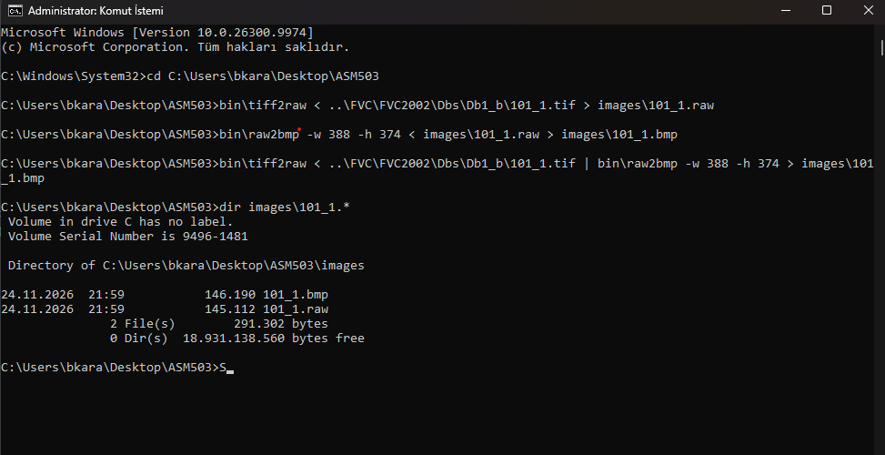

### 4.3 raw2an2k
Raw veriyi ANSI/NIST-ITL 1-2007 dosyasına çevirir. Dosya üç kayıttan oluşur: Type-1 (işlem bilgisi), Type-2 (açıklama) ve Type-14 (değişken çözünürlüklü parmak izi görüntüsü, sıkıştırmasız, 8 bit). Genişlik ve yükseklik dışındaki alanlar sabittir: 500 ppi, tarih 20020101, kurum kodu ASM503, baskı tipi "canlı tarama / düz", parmak pozisyonu "bilinmiyor".

```cmd
bin\tiff2raw < ..\FVC\FVC2002\Dbs\Db1_b\101_1.tif | bin\raw2an2k -w 388 -h 374 > images\101_1.an2k
..\nbis\bin\mindtct images\101_1.an2k images\mindtct_results\101_1
```
- Doğrulama: NBIS'in `an2k2txt` aracı dosyayı hatasız çözümler; `txt2an2k` aynı metin dökümünden byte byte aynı dosyayı üretir; `mindtct` 33 minutia bulur.

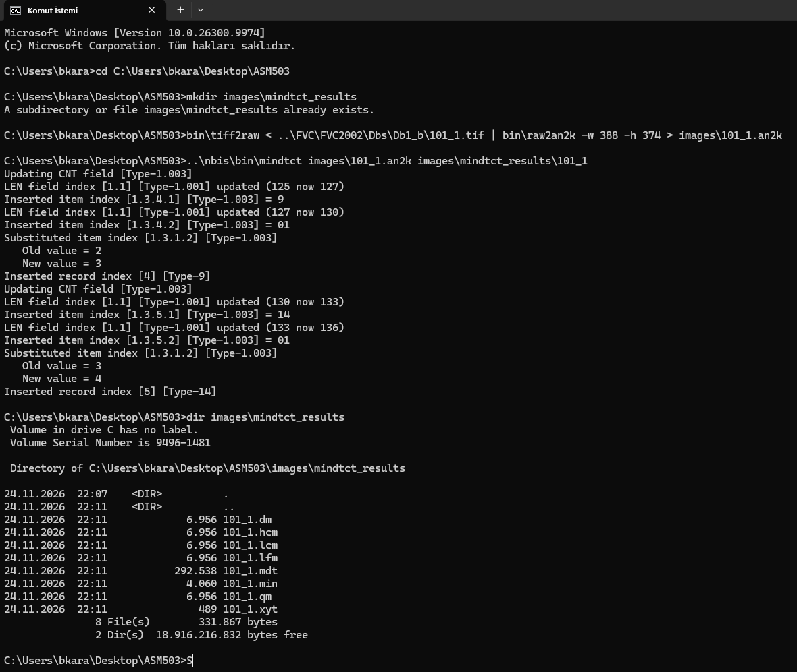

### 4.4 comp_img
Aynı boyutta iki 8-bit BMP'yi karşılaştırır ve Σ|g1 − g2| ile max|g1 − g2| değerlerini yazar.

```cmd
bin\tiff2raw < ..\FVC\FVC2002\Dbs\Db1_b\101_1.tif | bin\raw2bmp -w 388 -h 374 > result.bmp
python scripts\perturb_bmp.py result.bmp your_result.bmp
bin\comp_img result.bmp your_result.bmp
```
```
Total difference: 5
Maximum difference: 1
```
`perturb_bmp.py`, BMP'nin 5 pikselini 1 artırıp azaltır (başlığa ve padding byte'larına dokunmaz).

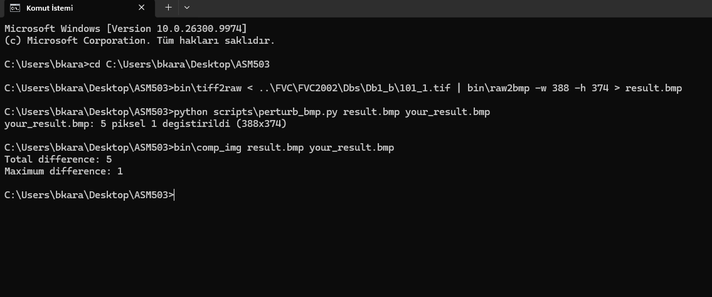

---

## 5. Parmak izi iyileştirme araçları

pyfing'deki klasik (derin öğrenme kullanmayan) yöntemlerin C uyarlamalarıdır. Tüm sabitler ve eşik değerleri pyfing'in varsayılan parametreleriyle aynıdır. Hepsi standart girişten raw görüntü, `-w/--width` ve `-h/--height` argümanlarını alır; sonucu standart çıkışa raw olarak yazar.

| Araç | pyfing yöntemi | Ek argümanlar | Çıktı |
|---|---|---|---|
| `segmentation` | GMFS (Gradient-Magnitude Fingerprint Segmentation) | – | maske: 255 = parmak izi, 0 = arka plan |
| `orientation` | GBFOE (Gradient-Based Fingerprint Orientation Estimation) | `-s` | sırt yönü: `round(θ · 255 / π)` |
| `frequency` | XSFFE (X-Signature Fingerprint Frequency Estimation) | `-s -o` | sırt periyodu: `round(periyot · 10)`, arka plan 0 |
| `gabor_filter` | GBFEN (Gabor-Based Fingerprint ENhancement) | `-s -o -f` | iyileştirilmiş görüntü (siyah zemin, beyaz sırt) |

```cmd
mkdir ..\work
bin\tiff2raw < ..\FVC\FVC2002\Dbs\Db1_b\101_1.tif | bin\segmentation -w 388 -h 374 > ..\work\segmentation_mask
bin\tiff2raw < ..\FVC\FVC2002\Dbs\Db1_b\101_1.tif | bin\orientation -w 388 -h 374 -s ..\work\segmentation_mask > ..\work\orientation_image
bin\tiff2raw < ..\FVC\FVC2002\Dbs\Db1_b\101_1.tif | bin\frequency -w 388 -h 374 -s ..\work\segmentation_mask -o ..\work\orientation_image > ..\work\frequency_image
bin\tiff2raw < ..\FVC\FVC2002\Dbs\Db1_b\101_1.tif | bin\gabor_filter -w 388 -h 374 -s ..\work\segmentation_mask -o ..\work\orientation_image -f ..\work\frequency_image | bin\raw2bmp -w 388 -h 374 > ..\work\101_1_filtered.bmp
```

| segmentation | orientation |
|---|---|
| 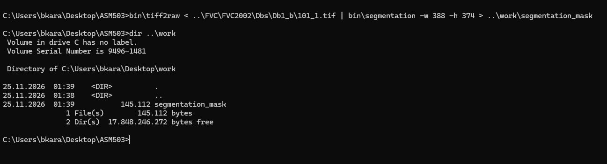 | 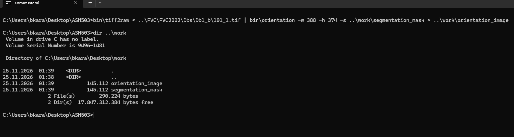 |
| **frequency** | **gabor_filter** |
| 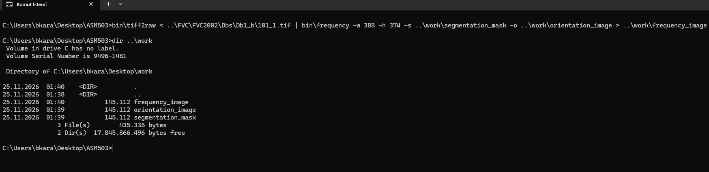 | 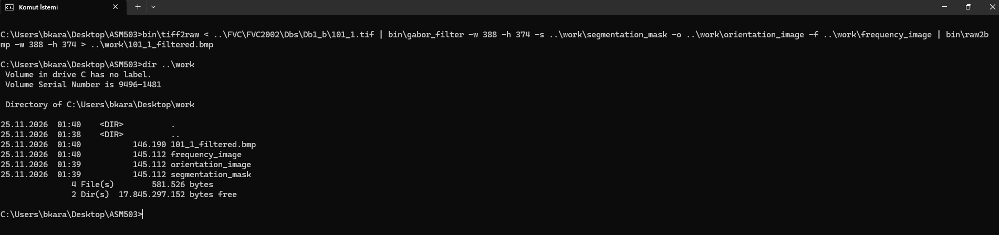 |

### 5.1 Tasarım notları

- **Araçlar arası veri kodlaması.** pyfing'de yön ve sırt periyodu ondalıklı (float) değerlerdir. Araçlar arasında 8-bit raw görüntü olarak aktarılabilmeleri için pyfing'in kendi derin öğrenme modellerinin (SNFFE/SNFEN) girdi kodlaması kullanılmıştır: yön `round(θ·255/π)` (0,7° adım), periyot `round(p·10)` (0,1 piksel adım). Bu sayede ara çıktılar `raw2bmp` ile görüntü olarak da incelenebilir. GBFEN yönü 12, periyodu 7 kademeye yuvarladığından bu kodlamanın sonuca etkisi küçüktür (bkz. 5.2).
- **OpenCV ile birebir uyum.** pyfing'in her adımı bir OpenCV/numpy fonksiyonudur. Bunlar `src/common/fpimg.c` ve araçların içinde, OpenCV'nin kenar işleme (`BORDER_REFLECT_101` vb.), yuvarlama ve ara veri tipleri taklit edilerek yazılmıştır: Gauss filtresi (8-bit için OpenCV'nin bit-exact sabit noktalı uygulaması), medyan, Sobel, numpy yüzdeliği ve float32 *pairwise* toplamı, morfoloji, bağlı bileşenler, satranç tahtası uzaklık dönüşümü, `cv::phase`'in polinom atan2 yaklaşımı, `warpAffine`, Navier-Stokes `inpaint`, `resize` ve `getGaborKernel`.
- **OpenCV 5'in warpAffine'i.** Kurulan OpenCV 5.1'de `warpAffine`, 4.x'teki sabit noktalı tablo yönteminden farklı olarak float koordinat ve FMA ile çalışan yeni çekirdekleri (`warp_kernels.simd.hpp`) kullanır. `frequency` bu yeni davranışa göre yazılmıştır; inpaint de OpenCV'nin `inpaint.cpp` kaynağındaki algoritmayı izler.
- **gabor_filter** her pikselde yalnızca o pikselin yön ve periyoduna karşılık gelen Gabor çekirdeğini uygular (pyfing tüm görüntüyü gereken her çekirdekle filtreleyip sonra seçer). Sonuç aynıdır, işlem sayısı çok daha azdır. pyfing'deki gibi maske filtrelemede kullanılmaz; `-s` argümanı arayüz tutarlılığı için alınır.

### 5.2 pyfing ile karşılaştırma

FVC2000/2002/2004'ün tüm veri tabanlarından rastgele seçilen görüntülerle, pyfing'in aynı yöntemine (`method="GMFS"` vb.) karşı piksel piksel:

| Araç | Aynı girdiyle birebir aynı piksel oranı | Not |
|---|---|---|
| segmentation | **%100** (301/301 görüntüde tamamen aynı) | |
| orientation | **%99,9996** | farklı pikseller en fazla 1 kademe (0,7°) |
| frequency | **%100,00** | çok nadir 0,1 piksel fark (float yuvarlaması) |
| gabor_filter | **%99,999** | en fazla 1 gri seviye fark (OpenCV büyük çekirdeklerde FFT kullanır) |
| **Tam zincir** (pyfing'in float değerleriyle) | **%99,02** | farklar, 8-bit kodlamanın GBFEN kova sınırlarına denk gelen piksellerinde |

Dört aracın toplam süresi görüntü başına yaklaşık 0,3 saniyedir.

---

## 6. Parmak izi eşleştirme

### 6.1 Sistem
```
.tif → tiff2raw → segmentation → orientation → frequency → gabor_filter
     → ters çevirme → raw2an2k → mindtct (.xyt) → bozorth3 → skor
```
gabor_filter çıktısı siyah zemin üzerinde beyaz sırtlardır; mindtct klasik parmak izi görüntüsü (açık zemin, koyu sırt) beklediği için görüntü mindtct'den önce ters çevrilir.

### 6.2 FVC protokolü
Her veri tabanının A kümesi (100 parmak × 8 örnek) kullanılır:
- **Genuine:** aynı parmağın örnekleri birbiriyle, simetrik karşılaştırmalar hariç: 100 × (8·7/2) = **2800**
- **Impostor:** farklı parmakların ilk örnekleri birbiriyle, simetrikler hariç: 100·99/2 = **4950**

### 6.3 Çalıştırma
PowerShell'de, depo dizininde:
```powershell
.venv\Scripts\python scripts\match.py     # üç veri tabanı, ~5 dk (12 iş parçacığı)
.venv\Scripts\python scripts\det.py
```
- `match.py` skorları `scores/FVC200XDB1_genuine_scores.txt` ve `scores/FVC200XDB1_impostor_scores.txt` dosyalarına yazar (her satır: `şablon sorgu skor`, örn. `1_1 1_2 87`).
- Gabor çıktıları (`*_filtered.bmp`) ve minutiae dosyaları (`*.xyt`) çalışma dizininin dışında, `../work/<veri tabanı>/` altında tutulur. Daha önce işlenmiş görüntüler yeniden işlenmez; betik yarıda kesilirse kaldığı yerden devam eder.
- Seçenekler: tek veri tabanı (`match.py FVC2002DB1`), hızlı deneme (`--fingers 10`), farklı dizinler (`--fvc`, `--nbis`, `--work`, `--out`), iş parçacığı sayısı (`--jobs`), yeniden işleme (`--force`). Ayrıntılar: `match.py --help`.
- `det.py`, `images/FVC200XDB1_det.png` dosyalarını üretir.

### 6.4 DET eğrisi ve EER
Eşik *t* için (skor ≥ *t* ise "aynı parmak"): FAR(*t*) eşiği geçen impostor skorlarının, FRR(*t*) eşiğin altında kalan genuine skorlarının oranıdır. DET eğrisi iki ekseni de logaritmik olarak FAR'a karşı FRR'yi gösterir. Skorlar tam sayı olduğundan FAR ve FRR çoğu zaman tam aynı noktada kesişmez; EER, FVC'nin tanımıyla (Maio vd., FVC2000) kesişmenin iki yanındaki eşiklerden bulunan [EER_alt, EER_üst] aralığının ortası olarak hesaplanır.

### 6.5 Gözlemler
FVC2002 DB1 üzerinde yapılan ek deneyler:

| Sistem | EER |
|---|---|
| **gabor_filter + ters çevirme + mindtct** (teslim edilen sistem) | **%3,98** |
| gabor_filter, ters çevirmeden + mindtct | %3,77 |
| gabor_filter + segmentation maskesi + ters çevirme + mindtct | %4,96 |
| İyileştirme yok (ham görüntü + mindtct) | %3,21 |

- mindtct'nin kendi içinde görüntü iyileştirme ve ikilileştirme adımları vardır; bu nedenle gabor ön işlemesi bu veri tabanında EER'i iyileştirmemiştir. GBFEN maske dışını da filtreleyerek arka planda sahte sırt desenleri bırakır.
- Maske dışını temizlemek sonucu kötüleştirmiştir: maske sınırında sırtlar aniden kesildiğinden mindtct sınır boyunca sahte sırt sonları bulur.
- Ters çevirip çevirmemek arasındaki fark (0,2 puan), 2800 genuine karşılaştırmayla elde edilen EER'in istatistiksel belirsizliği içindedir. Sırt ve vadi birbirinin negatifi olduğundan (sırt sonu ↔ vadi çatallanması) mindtct iki durumda da benzer minutiae bulur. mindtct'nin tasarlandığı koyu sırtlı görüntüyü verdiği için ters çevirme tercih edilmiştir.

---

## 7. Teslim edilen dosyalar

| Ödev maddesi | Dosya(lar) |
|---|---|
| NBIS kurulumu | `images/nbis_install.png` |
| pyfing kurulumu | `images/pyfing_install.png`, `scripts/pyfing_example.py` |
| tiff2raw, raw2bmp | `src/tiff2raw/`, `src/raw2bmp/`, `images/raw_tools.png`, `images/101_1.bmp` |
| raw2an2k | `src/raw2an2k/`, `images/an2k-mindtct.png`, `images/mindtct_results/`, `images/101_1.an2k` |
| comp_img | `src/comp_img/`, `images/comp_img.png`, `scripts/perturb_bmp.py` |
| segmentation, orientation, frequency, gabor_filter | `src/<araç>/`, `src/common/`, `images/segmentation.png`, `images/orientation.png`, `images/frequency.png`, `images/gabor_filter.png` |
| match.py ve 6 skor dosyası | `scripts/match.py`, `scores/` |
| det.py ve 3 DET eğrisi | `scripts/det.py`, `images/FVC2000DB1_det.png`, `images/FVC2002DB1_det.png`, `images/FVC2004DB1_det.png` |

Depo, `make clean` yapılmış haldedir: derleme çıktıları (`.o`, `.exe`) içermez. FVC veri tabanları ve gabor çıktıları depoya dahil değildir.
